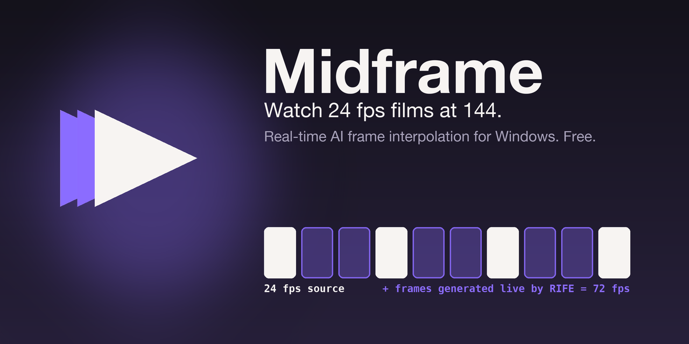

<p align="center"></p>
<p align="center"><strong>Watch 24 fps films at 144. Watch 30 fps YouTube at 60.</strong><br>
A Windows video player that generates the missing frames in real time, on your NVIDIA GPU.</p>

<p align="center">
<a href="#1-why-midframe">Why</a> ·
<a href="#2-features">Features</a> ·
<a href="#3-requirements">Requirements</a> ·
<a href="#4-install">Install</a> ·
<a href="#5-using-midframe">Use</a> ·
<a href="#6-youtube">YouTube</a> ·
<a href="#7-how-it-works">How it works</a> ·
<a href="#8-troubleshooting">Troubleshooting</a> ·
<a href="#9-developing">Developing</a>
</p>

---

Films are shot at 24 frames per second. Your monitor can show 144. Midframe fills the gap: every frame in between
is generated live by [RIFE](https://github.com/hzwer/ECCV2022-RIFE), an AI interpolation model, running on TensorRT
while you watch. No downloading, no re-encoding, no waiting. Open a file or paste a YouTube link and press play.

## 1. Why Midframe

Smooth, interpolated playback on Windows has mostly meant one thing: SVP, a mature and capable product, but a
paid one. The free tools around it work differently. Flowframes, RIFE-App and friends are converters: you hand
them a file, wait, and get a new, larger file back. That's ideal for archiving, but it doesn't help with the video you
want to watch right now, or with a YouTube link.

Midframe is a free, open-source player that interpolates on demand, while you watch, for local files and streams
alike. Nothing is written to disk and there's nothing to wait for. If you have an RTX card and a high-refresh
display, this is the missing piece.

Tested on an RTX 4050 Laptop (6 GB): 1080p at 2× and 3× and YouTube 1080p 30→60 play with **zero dropped frames**.

## 2. Features

| | |
|---|---|
| **Real-time AI interpolation** | RIFE 4.26 and 4.6 on NVIDIA TensorRT. 1.5×, 2×, 2.5×, 3×, a fixed 60/90/120/144, or any value you type. |
| **Local files and YouTube** | Drag a file in or paste a link. YouTube quality from 480p to 2160p, switchable without reloading. |
| **Never stutters** | Every engine is benchmarked once on *your* GPU. A video starts at the level that keeps up and steps down rather than drop frames. |
| **Picture fill** | Removes black bars without touching interpolation: detects letterboxing, then blends zoom and stretch so neither is extreme. Manual values too. |
| **Anime-aware** | Held drawings stay held and scene cuts are never blended. Switch it off for live action if you prefer. |
| **Nothing to tune** | Engines build themselves in the background, levels pick themselves. One setup sheet per video, or none. |
| **Crash recovery** | If the player ever dies, it reopens the same file at the same second. |
| **Debug overlay** | One key shows level, drops, GPU clock, measured refresh rate, picture settings and live graphs. |
| **Built on the best** | [mpv](https://mpv.io), [VapourSynth](https://www.vapoursynth.com), [vs-mlrt](https://github.com/AmusementClub/vs-mlrt), [uosc](https://github.com/tomasklaen/uosc), [yt-dlp](https://github.com/yt-dlp/yt-dlp). Free, MIT licensed. |

## 3. Requirements

| | |
|---|---|
| **OS** | Windows 10 or 11, 64-bit |
| **GPU** | NVIDIA RTX 20-series or newer with a current Game Ready or Studio driver. Integrated and AMD GPUs are not supported (RIFE runs on CUDA/TensorRT). |
| **VRAM** | 4 GB for 1080p, 6 GB recommended for 1440p and 4K |
| **Disk** | About 6 GB for the install, plus 1–2 GB of generated engines |
| **Display** | Any. A 120/144 Hz panel is where it shines. |
| **Optional** | [Node.js](https://nodejs.org): yt-dlp uses it as a JavaScript runtime, which YouTube now needs for the full list of formats |

## 4. Install

### 4.1 Download and run the setup

Get the setup from the [latest release](https://github.com/thewecas-dev/Midframe/releases/latest). It comes as
`Midframe-Setup` plus several `.bin` slices; keep them all in one folder, then run it. It installs to
`%LOCALAPPDATA%\Midframe` and needs no admin rights. Every push to `main` also builds one on GitHub Actions,
downloadable from the workflow run as an artifact.

### 4.2 Three Windows settings (do them once)

These make or break smooth playback.

| Setting | Where | Why |
|---|---|---|
| GPU → **High performance** | Settings → System → Display → Graphics → *Add desktop app* → `%LOCALAPPDATA%\Midframe\mpv.exe` → Options | Otherwise the GPU idles at a few hundred MHz during playback |
| **G-SYNC off** | NVIDIA Control Panel → *Set up G-SYNC* → untick *Enable G-SYNC* (or at least for windowed mode) | Variable refresh rate fights mpv's frame pacing |
| **Fixed refresh rate** | Settings → System → Display → Advanced display → set 144 Hz, not *Dynamic* | Same reason |

Settings → System inside Midframe checks these for you.

### 4.3 First launch

Start Midframe from the Start menu. The first launch builds and benchmarks the RIFE engines for 1080p in the
background (10–20 minutes, one time only). The start screen says **RIFE ready** when it's done. Keep a laptop
plugged in while it runs. You can pin the running window to the taskbar; a direct start of `mpv.exe` re-launches
itself through the launcher so the engines are always found.

## 5. Using Midframe

### 5.1 Home screen

Drop a video on it, click **Open file…** (the normal Windows dialog), or paste a link into the field and click
**Play link**. Recent videos sit on the right and resume where you stopped (right-click a card to remove it). The strip
at the bottom shows engine and system state at a glance.

### 5.2 The setup sheet

One sheet appears before each video. For YouTube it lists the qualities that stream actually has and the frame-rate
tiles; for local files the frame-rate tiles alone. Tiles are grouped into rates that divide your display refresh
evenly and the rest, each with a hint from your GPU's calibration ("2× · 3 refreshes", "needs 4.6 quarter",
"too heavy"). A strip underneath previews the result: `23.976 → 47.952 fps · RIFE 4.6 · plays smoothly`.

Enter plays, Esc keeps the defaults, **Custom** takes a typed value, ← → move between tiles, ↑ ↓ change quality,
and "Don't ask again" remembers your answer per kind (YouTube / local).

**Pick a target that divides your refresh rate.** On a 144 Hz display: 2× (48) or 3× (72) for films, 2× (60) for
30 fps video. 60 fps on 144 Hz is an uneven 2.4 refreshes per frame and looks worse than 48. The sheet marks the even ones.

### 5.3 Keys and bar buttons

| Key | Action |
|---|---|
| **Ctrl+O** | Open a file |
| **Ctrl+V** | Play the link or file path on the clipboard |
| **f** | Frame-rate quick menu (same tiles, plus custom and the interpolation toggle) |
| **z** | Picture fill: Fit → Fill → Zoom → Stretch → Manual |
| **Ctrl+,** | Settings |
| **d** | Debug overlay |
| **F11** or double-click | Fullscreen |
| **Space**, **← →** | Pause, seek |
| **Ctrl+− / Ctrl++** | Audio offset ±100 ms |
| **Shift+I** | mpv's own stats page |

The bottom bar has play/pause and ±10 s on the left; quality (opens the sheet), frame rate, picture fill, subtitles,
debug, settings and fullscreen on the right. While a sheet, menu or drawer is open it owns the keyboard and the
wheel, so nothing leaks to the player.

### 5.4 Picture fill (black bars)

The picture-fill panel (bar button or `z`) removes bars without touching interpolation, because it only changes how
mpv displays the finished frames.

- **Picture area.** Baked-in letterbox bars are detected from the picture itself (Auto), or forced with the
  2.39:1 / 2.0:1 / 1.85:1 / 16:9 chips when detection can't see dark-grey streamed bars. Off disables cropping.
- **Fill** closes the remaining mismatch with your screen by splitting the difference between zooming in and
  stretching, so neither is extreme; drag the balance slider towards *stretch* or *zoom*.
- **Zoom** and **Stretch** do all of one. **Manual** gives separate zoom and stretch values: type them, step with
  − / +, or use ← → and the wheel on the focused field.

Choices are remembered per video; Settings → Playback → Picture sets the default for new ones. The debug overlay's
"picture" row shows the active crop and factors.

### 5.5 Settings (Ctrl+,)

| Tab | What's there |
|---|---|
| **Playback** | Ask before YouTube / local files, default frame rate and quality, YouTube sign-in, faithful anime mode, prefer even frame rates, headroom, picture fill defaults, audio offset |
| **Engines** | Per-resolution engine status with measured speeds; *Prepare now* builds a size ahead of time |
| **System** | GPU preference, refresh rate / G-SYNC (measured during playback), engines, driver |
| **Keys** | The table above |

## 6. YouTube

**Quality.** "Auto" picks the best stream up to your screen's height; the sheet lists the others. Switching quality
is instant (formats are loaded as tracks, nothing reloads).

**New resolutions.** The first video at 720p, 1440p or 4K plays at its original rate for a few minutes while the
engine for that size builds, then interpolation switches on by itself.

**"Sign in to confirm you're not a bot".** YouTube rate-limits anonymous players. Give yt-dlp your own login once:

1. In your browser, install the **Get cookies.txt LOCALLY** extension.
2. Open youtube.com while signed in, click the extension and export the cookies for the current site.
3. Save the file as `portable_config\youtube-cookies.txt` inside the install folder.
4. In Midframe: Settings → Playback → **YouTube sign-in → cookies.txt file**.

The file is your YouTube login, so don't share it; re-export when links start failing again (cookies expire).
Firefox users can pick "Firefox" instead and skip the export. Chrome, Edge and Brave encrypt their cookie store,
which is why those options usually fail with "Failed to decrypt with DPAPI".

## 7. How it works

**Pipeline.** mpv decodes; a VapourSynth filter converts frames to RGB, runs RIFE through vs-mlrt on TensorRT with
static per-resolution engines (fp16 in and out, CUDA graphs), and hands the new frames back; mpv renders with
display-resample timing. Picture fill happens in the renderer afterwards, so it never affects the filter.

**Calibration.** Every engine is measured once on your GPU (`portable_config\engines\cal_<w>x<h>.json`). A video
starts at the best level whose measured speed covers the frames it needs with 50% headroom; unmeasured sizes are
estimated from the nearest measured one. The ladder, best quality first:

> RIFE 4.26 → RIFE 4.6 → RIFE 4.6 half scale → RIFE 4.6 quarter scale → lower target fps → original fps

**Auto mode.** During playback it only ever steps down (a level change reloads the filter, a 1–2 s pause), and a
level that failed stays blocked until the next file. If the filter itself fails (driver, VRAM) the video keeps
playing at its original rate and a notice says why.

**Anime.** With faithful mode on, held drawings are detected by frame difference and kept as holds, and hard cuts are
never interpolated across.

## 8. Troubleshooting

Press **d** first. The overlay answers most questions:

| Overlay shows | Meaning | Fix |
|---|---|---|
| `gpu 600 / 3105 MHz · P5` | GPU parked in power saving | Windows Graphics setting → High performance (4.2) |
| `display 144 Hz · measured 48.3` in amber | the panel follows the video (variable refresh) | Turn off G-SYNC, set a fixed refresh rate (4.2) |
| `preparing RIFE 4.6…` in the status line | an engine is being built | Wait; original fps meanwhile |
| "Could not play: Sign in to confirm…" | YouTube wants a login | Section 6 |
| "Interpolation turned off: …" | filter error | `portable_config\midframe-error.log` |
| "RIFE setup failed" | engine build error | `portable_config\engines\build-error.log`; usually a driver or CUDA problem (`nvidia-smi` must work) |

Settings → **Open config folder** opens `portable_config`, which holds your preferences, recents, engines and the
logs. For anything else, start `mpv.exe --log-file=midframe.log` from the install folder, reproduce, and attach
the log and an overlay screenshot to an issue.

To benchmark the pipeline outside mpv (prints raw RIFE and full-filter fps per level and records the calibration;
run only while Midframe is closed):

```
vs-runtime\python.exe portable_config\vs\bench.py [width height]
```

## 9. Developing

### 9.1 Build the installer

On Windows, with [7-Zip](https://www.7-zip.org) and [Inno Setup 6](https://jrsoftware.org/isinfo.php) on PATH
and about 10 GB free:

```powershell
powershell -ExecutionPolicy Bypass -File packaging\build.ps1
```

It downloads pinned versions of mpv, VapourSynth, vs-mlrt with the TensorRT runtime, the RIFE models, uosc and
yt-dlp, adds this repo's `portable_config`, stamps the icon into `mpv.exe` and produces the setup plus `.bin`
slices in `dist\`. The same script runs in `.github/workflows/build.yml`. The icon is drawn by
`packaging\make_icon.py` (Pillow).

### 9.2 Layout

| Path | Role |
|---|---|
| `portable_config/scripts/midframe/main.lua` | mpv wiring: hooks, state, modal overlays, engine builds, auto mode, picture fill |
| `…/ui.lua`, `home.lua`, `sheet.lua`, `settings.lua`, `overlay.lua` | the UI: a small ASS widget kit and pure screen builders (model in, canvas out) |
| `…/fps.lua`, `auto.lua`, `fill.lua` | pure logic: frame-rate math, level selection, bar detection and zoom/stretch math |
| `portable_config/vs/` | the VapourSynth side: `mf_vs.py` builds the filter graph, `build_engines.py` measures levels, `ladder.json` defines them |
| `packaging/` | build script, launcher with crash recovery, installer, icon |
| `tests/` | `tests/run.sh` runs everything |

### 9.3 Tests (any OS)

```
tests/run.sh
```

Needs `lua` and `python3`. Set `VS_PYTHON` to a Python with VapourSynth installed to also run the real filter-graph
test (the GPU part is stubbed). Covers the fps math, auto step-down, bar detection and fill math, every UI screen,
mpv wiring against a stub mpv, the frame-hold logic and the filter graph. The UI can be driven from outside with
`script-message-to midframe action '{"kind":…}'`, which the tests use.

### 9.4 Contributing

Issues with an overlay screenshot and `midframe.log` are the most useful thing you can send. Pull requests: keep
`tests/run.sh` green, and if you change `ladder.json` re-run `bench.py` and mention the numbers.

## 10. Licenses

Midframe's own code is MIT (see `LICENSE`). The installer bundles third-party software under its own terms:
mpv (GPL-2.0+/LGPL-2.1+), VapourSynth (LGPL-2.1), vs-mlrt (GPL-3.0) with NVIDIA TensorRT and CUDA runtime
libraries (NVIDIA EULA, redistributable), the RIFE models (MIT, from the vs-mlrt model releases), uosc (LGPL-3.0),
yt-dlp (Unlicense). Streaming a site's content is subject to that site's terms.
